# Birch Design Lab

We are a small studio on the Mississippi Gulf Coast that builds custom software and websites. This repository is the source of [birchdesignlab.com](https://birchdesignlab.com/): our business site, and the Lab where we hang our work.

*The home page moving between design schools in the Portal, one of the pieces in the Lab.*

The site is a static Astro build served from Cloudflare, with one small Worker for the contact form and card scans.

## At a glance

| | |
|---|---|
| Live site | [birchdesignlab.com](https://birchdesignlab.com/) |
| Built with | Astro 7 (static output), Svelte 5 islands, three.js for the 3D pieces |
| Hosted on | Cloudflare Workers: static assets plus one Worker, deployed on every merge to main |
| Tested by | A Vitest suite, plus a second suite that inspects the built site, run on every pull request |
| Since | July 2026, with over a hundred pull requests by mid November |

The public pages are Home, About, Services, Contact (a real form), Privacy, the Lab and one page per piece, the Styleguide, three landing pages for the QR codes on our cards, and the Portal, which rebuilds the five business pages in each design school.

## The Lab

The Lab is our portfolio. Experiments are interactive pieces; studies are written accounts of client work and of our own research. Two genre studies, sites for businesses we invented to argue what a kind of site should do, hang with the experiments. Every piece keeps a permanent number, like a museum catalog, and a retired number is never reused. Every piece is live unless noted.

- **BDL-001 The Bark Engine.** The generative birch system that paints the site, opened up as an instrument you can play.
- **BDL-002 The Styleguide.** The tuning room: palettes, typefaces, a color checker, bark you can grow.
- **BDL-003 Novgorod Letters.** Medieval birch-bark letters you scratch to read. *Forthcoming.*
- **BDL-004 The Loom.** A weaving-draft instrument. *Retired:* built, shipped, then pulled on purpose. It rests in `attic/bdl-004/`.
- **BDL-005 Cheer and Chatter Social Club.** A study: a ticketing site and a live event app for game nights. The code lives in its own private repository.
- **BDL-006 The Regulator.** A color ramp that solves itself against the WCAG contrast rules, with a crown that retunes the bark live.
- **BDL-007 The Shining Tree.** Our organic wordmark in 3D, birch and moss breathing.
- **BDL-008 Magnolia and Mane.** Genre study: a Gulf Coast salon site, bilingual, with booking on the site.
- **BDL-009 Bayou Kitchen.** Genre study: a Gulf Coast restaurant site, menu first.
- **BDL-010 The Portal.** The whole site rebuilt in seven design schools, with a switcher that morphs one page into the next.
- **BDL-011 Field Guide to the Schools.** What each school believes and forbids, and what it took to build. *Forthcoming.*
- **BDL-012 The Data Map.** One picture of everything a small events business runs on, and where its information lives, travels and shows up. Drawn for a client, then hung in the Lab.
- **BDL-013 The Drawing Set.** bdlBase, the web framework we built, drawn as an engineering sheet: one file describes a business, and an arrow runs from each line to the part of the site it builds.

Each Lab entry is one Markdown file. In the chart, the tan box is that file, plain boxes are code, the green box is the Lab index, and the filled box is the piece's own page.

<picture>
  <source media="(max-width: 600px) and (prefers-color-scheme: dark)" srcset="assets/readme/charts/1-lab-specimens.phone.dark.svg">
  <source media="(max-width: 600px)" srcset="assets/readme/charts/1-lab-specimens.phone.light.svg">
  <source media="(prefers-color-scheme: dark)" srcset="assets/readme/charts/1-lab-specimens.dark.svg">
  
</picture>

Chart source (Mermaid)

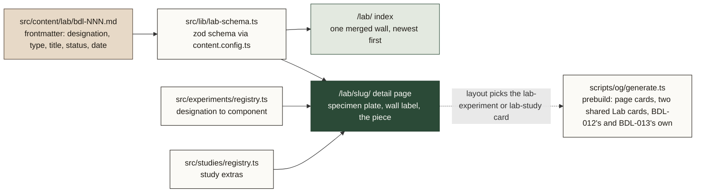

Each piece's page is laid out like a museum wall: a specimen plate, and a wall label that says how to operate it. Share images are generated at build time: one for each main page, one shared by all experiments and one by all studies. The home page's "From the lab" strip shows the three highest-numbered live pieces.

## The Portal: seven design schools

BDL-010 is the biggest piece here. Each school is the whole business site (Home, About, Services, Contact and the sent page) rebuilt in one design language at `/t/<school>/`. The words, links and form behavior are shared and fixed; everything visual belongs to the school. A switcher morphs the page from one school to the next with view transitions, and the wordmark is the one element that carries across.

| School | Route | Drawn from |
|---|---|---|
| quiet | `/t/quiet/` | Our own site, and the reference every school is checked against |
| swiss | `/t/swiss/` | Zurich and Basel, 1950s to 1960s |
| bauhaus | `/t/bauhaus/` | Weimar and Dessau, 1919 to 1933 |
| glassmorphism | `/t/glassmorphism/` | Big Sur and Windows 11, 2020 to 2021 |
| vaporwave | `/t/vaporwave/` | The 2010s internet, dreaming of 90s software and malls |
| grandmillennial | `/t/grandmillennial/` | The parlor revival of 2019 |
| cottagecore | `/t/cottagecore/` | Rural crafts and old recipe books, 2018 to 2020 |

<picture>
  <source media="(max-width: 600px) and (prefers-color-scheme: dark)" srcset="assets/readme/charts/2-portal-schools.phone.dark.svg">
  <source media="(max-width: 600px)" srcset="assets/readme/charts/2-portal-schools.phone.light.svg">
  <source media="(prefers-color-scheme: dark)" srcset="assets/readme/charts/2-portal-schools.dark.svg">
  
</picture>

Chart source (Mermaid)

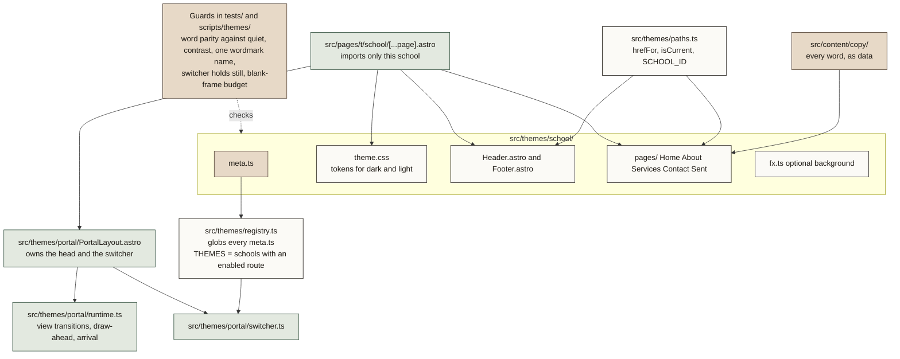

How a school is built and judged:

- Every visible word comes from the shared copy, checked by **word parity**, a test that compares each school to quiet word for word. Decorative text is hidden from screen readers, so it never counts as a word.
- Each school has a **dossier** of primary-source research under [theme-schools-research/dossiers](https://github.com/BirchDesignLab/birchdesignlab/tree/main/docs/superpowers/specs/theme-schools-research/dossiers), and revisions are judged against it.
- The **stage gates** ([stage-gates.mjs](https://github.com/BirchDesignLab/birchdesignlab/blob/main/scripts/themes/harness/stage-gates.mjs)) time every school's arrival and record the switcher frame by frame in a real browser at three screen sizes, in light and dark, checking that it holds still. They also run a control with the switcher's transition name removed, which must fail, so a pass means something. Then they record the wordmark morph.
- After the first build and a sweep for defects, we revised the schools in stages, one pair at a time, each judged against its dossier and the stage gates. The latest pair merged on 2026-11-17.

## How the site is served

Cloudflare's static assets layer serves every page and file from the edge. Only requests under `/api/*` reach the Worker (`run_worker_first` in `wrangler.jsonc`), and there are two of them: the contact form and a scan counter for the QR cards. A request that matches no file gets Astro's 404 page straight from the assets layer, so the Worker never sees it.

The contact form has one job: never lose a lead. A message passes five steps on its way to us:

1. A honeypot field. A bot that fills it gets a cheerful success page and no email is sent.
2. A rate limit of 5 posts per minute from one address.
3. Validation (`src/lib/contact/validate.ts`).
4. A daily cap of 40 valid messages, counted in Cloudflare KV, that stops a bot rotating through addresses. The cap fails open: if the count cannot be read, the message goes through, because a real lead matters more than an exact count.
5. The email itself. If sending fails, the message is held in KV for 30 days, the visitor sees a plain "your message is saved" page, and a job that runs once a day retries every held message until it sends or expires.

In the chart, the filled box is the Worker, green boxes are other Cloudflare services, tan boxes hold data, and a tick marks each check a message must pass.

<picture>
  <source media="(max-width: 600px) and (prefers-color-scheme: dark)" srcset="assets/readme/charts/3-served.phone.dark.svg">
  <source media="(max-width: 600px)" srcset="assets/readme/charts/3-served.phone.light.svg">
  <source media="(prefers-color-scheme: dark)" srcset="assets/readme/charts/3-served.dark.svg">
  
</picture>

Chart source (Mermaid)

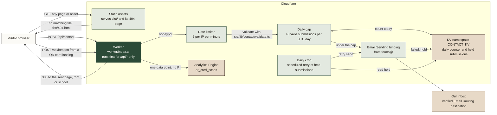

Decisions we made in this layer:

- The Worker runs first for `/api/*`, so the assets layer cannot answer a plain browser form post with a 405.
- The contact form works with JavaScript off. Errors come back as plain HTML pages, not JSON.
- Mail goes to a verified Email Routing destination, because sending to a routing address returns an error on Cloudflare's free plan.
- `public/_headers` sets the security headers on static pages. The Worker adds its own two, because `_headers` does not reach Worker responses.
- There is no Permissions-Policy header, on purpose: Lab pieces are meant to use the camera, location and motion sensors.
- Analytics runs at Cloudflare's edge, not in our code. Google Analytics and the Meta Pixel load only after a visitor opts in, and Cloudflare Web Analytics counts page views without cookies. Our record of that setup is [docs/analytics.md](https://github.com/BirchDesignLab/birchdesignlab/blob/main/docs/analytics.md).
- A second Worker in `share/` serves share.birchdesignlab.com and is deployed on its own.

## Repository map

The trunk is the repository root. Along it, plain boxes are code, green boxes run outside the static site (the two Workers and our agent setup), and tan boxes are the record: scripts, docs, media and retired work.

<picture>
  <source media="(max-width: 600px) and (prefers-color-scheme: dark)" srcset="assets/readme/charts/4-repo-map.phone.dark.svg">
  <source media="(max-width: 600px)" srcset="assets/readme/charts/4-repo-map.phone.light.svg">
  <source media="(prefers-color-scheme: dark)" srcset="assets/readme/charts/4-repo-map.dark.svg">
  
</picture>

Chart source (Mermaid)

```mermaid
flowchart TB
    classDef store fill:#e7d9c7,stroke:#4a3a2c,color:#1f1b15
    classDef cloud fill:#e3e9e0,stroke:#2b4a37,color:#1f1b15
    classDef you fill:#fbfaf6,stroke:#1f1b15,color:#1f1b15

    ROOT["birchdesignlab/"]
    ROOT --> SRC["src/<br/>the Astro site"]:::you
    ROOT --> WORKER["worker/<br/>Cloudflare Worker"]:::cloud
    ROOT --> TESTS["tests/<br/>Vitest unit and dist tests"]:::you
    ROOT --> SCRIPTS["scripts/<br/>every script ever run, kept"]:::store
    ROOT --> DOCS["docs/<br/>live references, specs, archive"]:::store
    ROOT --> SHARE["share/<br/>share.birchdesignlab.com Worker, deployed on its own"]:::cloud
    ROOT --> ASSETS["assets/<br/>brand marks and this README's media"]:::store
    ROOT --> SOCIAL["social/<br/>video and card render pipeline"]:::you
    ROOT --> ATTIC["attic/<br/>parked work, BDL-004 The Loom (retired)"]:::store
    ROOT --> CLAUDE[".claude/<br/>agents, saved workflows"]:::cloud
    ROOT --> PUBLIC["public/<br/>favicons, robots, _headers, draco decoder"]:::you

    SRC --> PAGES["pages/<br/>routes incl. lab/ and t/"]
    SRC --> CONTENT["content/<br/>copy/ and lab/ collections"]
    SRC --> EXP["experiments/<br/>bdl-001 002 003 006 007 012 013"]
    SRC --> THEMES["themes/<br/>seven schools plus portal/"]
    SRC --> LIB["lib/<br/>bark engine, color, oklch, contact, seo, og, lab-schema, lab-sets"]
    SRC --> COMP["components/ layouts/ styles/"]

    SCRIPTS --> ST["themes/<br/>capture, recording, probes, proofs, harness"]
    SCRIPTS --> SB["brand/ og/ lab/ docs/ ar-card/ workflows/ build/ and more"]

    DOCS --> LIVE["deploy.md analytics.md ar-card/<br/>live references"]
    DOCS --> SP["specs<br/>how each live feature was designed"]
    DOCS --> TSR["Portal research<br/>dossiers, briefs, stage reports, handoffs"]
    DOCS --> ARCH["archive/<br/>dated handoffs, finished plans, superseded specs"]
```

| Where | What lives there |
|---|---|
| [src/content](https://github.com/BirchDesignLab/birchdesignlab/tree/main/src/content) | Every word a visitor reads, kept as data, and one Markdown entry per Lab piece |
| [src/themes](https://github.com/BirchDesignLab/birchdesignlab/tree/main/src/themes) | The seven design schools and the Portal runtime, with its own [README](https://github.com/BirchDesignLab/birchdesignlab/blob/main/src/themes/README.md) |
| [worker/index.ts](https://github.com/BirchDesignLab/birchdesignlab/blob/main/worker/index.ts) | The contact and scan endpoints |
| [.claude/workflows](https://github.com/BirchDesignLab/birchdesignlab/blob/main/.claude/workflows/README.md) | Our saved multi-agent workflows |

## How we work

### How a change reaches production

In the chart, plain boxes are the branch, its checks and its pull request, green boxes run on GitHub and Cloudflare, the tan box is the built site, and the filled box is the live site.

<picture>
  <source media="(max-width: 600px) and (prefers-color-scheme: dark)" srcset="assets/readme/charts/5-build-deploy.phone.dark.svg">
  <source media="(max-width: 600px)" srcset="assets/readme/charts/5-build-deploy.phone.light.svg">
  <source media="(prefers-color-scheme: dark)" srcset="assets/readme/charts/5-build-deploy.dark.svg">
  
</picture>

Chart source (Mermaid)

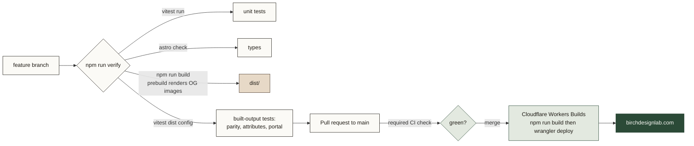

Every change goes on a branch and through a pull request. `npm run verify` is the gate: unit tests, type checks, the build, then tests over the built site. It is one command on purpose, because three separate commands were easy to skip. GitHub runs the same command on every pull request, and a red run blocks the merge.

Merging to main is the production deploy. Cloudflare builds and ships it but runs no tests, which is why the tests run before the merge. There is no staging site; the safety net is that any change can be reverted and redeployed. A manual deploy command exists for the day Cloudflare's builder is down, and since it ships whatever is on the machine rather than what was committed, it stays a last resort.

Two deliberate patches in `astro.config.mjs` keep the build honest: one drops unused copies of a three.js decoder from the bundle, the other restores CSS that a bundler change in Astro 7 deleted. Each is documented inline with the symptom that found it.

For dependencies, we stay on the newest stable releases, give every major upgrade its own pull request and a browser check, and judge each security advisory against our actual code rather than fixing by reflex.

### Agents, with a budget

We build with Claude Code and treat its agents as engineering infrastructure. Every agent we start names its model and how hard it should think: Haiku lists and extracts, Sonnet implements and checks, and Opus, the most capable, reviews, designs and handles the sensitive code. We made that a rule after a fleet of agents left on their defaults used up a month of usage in about ten minutes.

Visual work runs through two saved workflows. `bdl-task` takes one task on a feature branch. One agent implements it, a second confirms from git exactly which commit was built, and three reviewers check that commit at once: an Opus critic against the brief and the school's research, a Sonnet verifier that records every case in a real browser, and a Sonnet checker that runs `npm run verify` and confirms a clean tree. Real problems go back for up to two rounds of fixes; questions of style and scope come to us. `bdl-wave` runs several tasks back to back. The workflows are tested too, with a mock harness and a set of deliberately broken copies that the tests must catch. The details are in [.claude/workflows/README.md](https://github.com/BirchDesignLab/birchdesignlab/blob/main/.claude/workflows/README.md).

<picture>
  <source media="(max-width: 600px) and (prefers-color-scheme: dark)" srcset="assets/readme/charts/6-harness.phone.dark.svg">
  <source media="(max-width: 600px)" srcset="assets/readme/charts/6-harness.phone.light.svg">
  <source media="(prefers-color-scheme: dark)" srcset="assets/readme/charts/6-harness.dark.svg">
  
</picture>

Chart source (Mermaid)

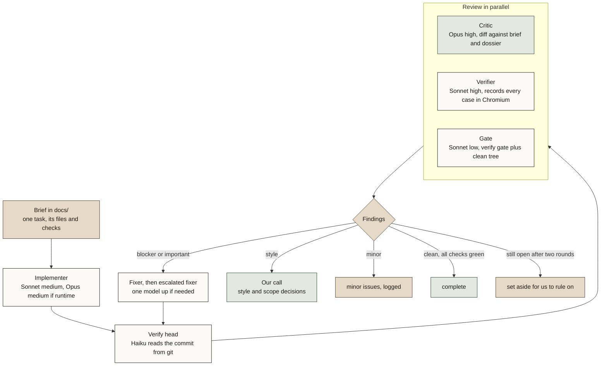

### Sensitive code

We name the parts of this repository where a mistake costs the most: the Worker and its contact route, secrets and `wrangler.jsonc`, `public/_headers`, analytics consent, and the verify gate with the merge that deploys. There is no login and no payment here, but a mistake in any of these is live the moment it merges. Changes there are written by Opus, and a branch that touches them gets a full Opus review before it merges.

### How decisions are recorded

Nothing important lives only in a conversation. Each feature has a written spec in [docs/superpowers/specs](https://github.com/BirchDesignLab/birchdesignlab/tree/main/docs/superpowers/specs). Each Portal stage ends with a report, such as the [Stage 4 report](https://github.com/BirchDesignLab/birchdesignlab/blob/main/docs/superpowers/specs/theme-schools-research/tier3-stage4/stage4-report.md), listing what changed, the decisions left for us, and what still needs checking on a real phone after deploy. The working rules our agents follow are in [CLAUDE.md](https://github.com/BirchDesignLab/birchdesignlab/blob/main/CLAUDE.md).

A few habits run through all of it. Every script we run, down to a one-off probe, is committed under `scripts/`, so a run that goes wrong can be read back and a job that returns can be run again. Every pull request is reviewed and merged by hand. Finished plans move to `docs/archive/` with their dates rather than being deleted.

What we don't cover yet: our recordings run in Chromium, so Safari and iOS are checked on a real phone after deploy rather than before, and the schools follow strict screen-reader rules but have not yet had a full screen-reader pass across all seven.

## Timeline

Dates are local (US Central).

<picture>
  <source media="(max-width: 600px) and (prefers-color-scheme: dark)" srcset="assets/readme/charts/7-timeline.phone.dark.svg">
  <source media="(max-width: 600px)" srcset="assets/readme/charts/7-timeline.phone.light.svg">
  <source media="(prefers-color-scheme: dark)" srcset="assets/readme/charts/7-timeline.dark.svg">
  
</picture>

Chart source (Mermaid)

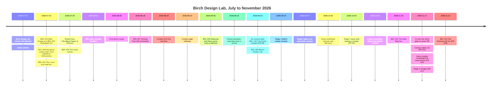

To talk about a project, use the form at [birchdesignlab.com/contact](https://birchdesignlab.com/contact/).

---

Copyright (c) 2026 Birch Design Lab. All rights reserved. See [LICENSE](LICENSE).
