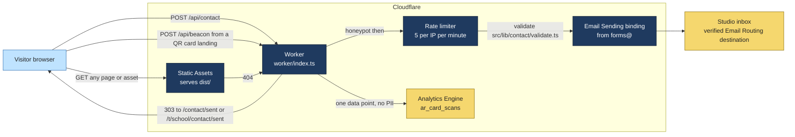
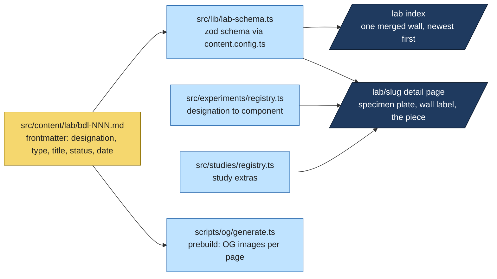
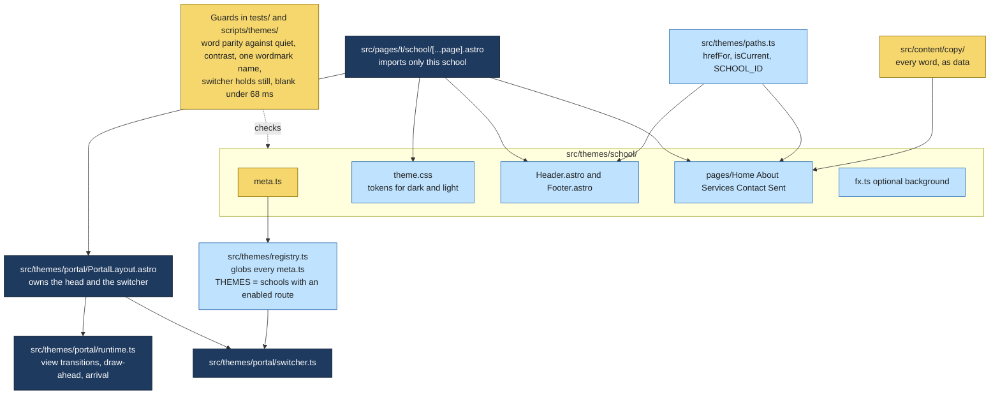
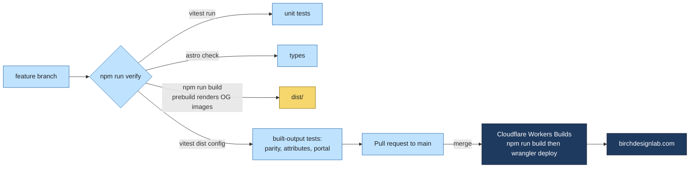
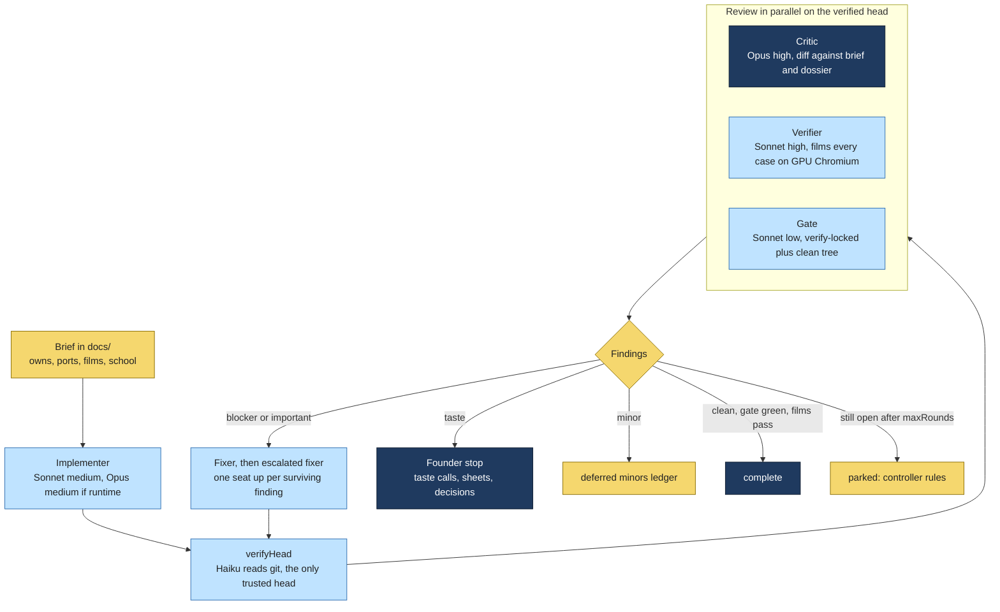
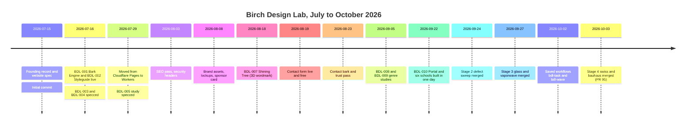

# Birch Design Lab

The source of [birchdesignlab.com](https://birchdesignlab.com): the business and portfolio site of Birch Design Lab, a one-person web design studio founded by Tyler Hobbs in July 2026. The site is an Astro static build served from Cloudflare Workers, with a small Worker for the contact form. The interesting part is the **Lab**: a growing set of numbered experiments and studies (BDL-001 through BDL-011) that double as the studio's portfolio, including a "Portal" that rebuilds the whole site in seven different design schools.

This is a fork at [github.com/wbp318/birchdesignlab](https://github.com/wbp318/birchdesignlab). Upstream is [github.com/BirchDesignLab/birchdesignlab](https://github.com/BirchDesignLab/birchdesignlab). This README was written for the fork to map the project before contributing; upstream does not carry one.

**Credo, from the founding record:** *First green after the fire, and the bark you write on.* Birch is the pioneer species that returns first after a burn, and birch bark was the paper of medieval Novgorod. Both ideas run through the brand, the copy and the experiments.

---

## Contents

1. [What is here at a glance](#what-is-here-at-a-glance)
2. [How the site is served](#how-the-site-is-served)
3. [Repository map](#repository-map)
4. [The Lab: specimens](#the-lab-specimens)
5. [The Portal: design schools](#the-portal-design-schools)
6. [Build, verify and deploy](#build-verify-and-deploy)
7. [The Claude Code harness](#the-claude-code-harness)
8. [Timeline](#timeline)
9. [Where it stands and how to help](#where-it-stands-and-how-to-help)
10. [What the fork does not have](#what-the-fork-does-not-have)
11. [Local setup](#local-setup)
12. [House rules](#house-rules)

---

## What is here at a glance

| Fact | Value |
|---|---|
| Live site | [https://birchdesignlab.com](https://birchdesignlab.com) |
| Framework | Astro 7 (static output), Svelte 5 islands, three.js for the 3D pieces |
| Host | Cloudflare Workers (Static Assets plus one Worker), deployed by Workers Builds on merge to main |
| Tests | Vitest (unit, about 50 files under tests/) plus a second Vitest config that inspects the built dist/ |
| Commits | 616 on main, 2026-07-15 to 2026-10-03, 95 pull requests |
| Authors | Tyler Hobbs (THobbs23, 527 commits) and the studio account (89 commits) |
| Tracked files | 918 |
| Dev tooling | Claude Code with saved multi-agent workflows (`bdl-task`, `bdl-wave`) and a strict model-tiering policy |

Public pages: Home, About, Services, Contact (a real form), Privacy, the Lab index and one page per specimen, the Styleguide, three QR-card landings (`/hello`, `/showcase`, `/greetings`) and the Portal at `/t/<school>/` with five business pages per school.

---

## How the site is served

Everything static is served from the edge. The Worker only sees requests that match no file, which in practice means two POST endpoints.



Notes that matter when touching this layer:

- `wrangler.jsonc` sets `run_worker_first` for `/api/*` so a browser form POST is not swallowed by the assets layer with a 405.
- The contact form works with JavaScript off. Errors are plain HTML pages, not JSON.
- The recipient must be a verified Email Routing destination. Sending to a routing address like `hello@` returns 502 on the free plan.
- `public/_headers` sets the security headers on static responses. The Worker adds its own two (Referrer-Policy, X-Frame-Options) because `_headers` does not apply to Worker responses.
- No Permissions-Policy header, on purpose: the Lab intends to use camera, location and sensors. See [docs/deploy.md](https://github.com/wbp318/birchdesignlab/blob/main/docs/deploy.md).
- Analytics consent (Cloudflare Zaraz) is documented in [docs/analytics.md](https://github.com/wbp318/birchdesignlab/blob/main/docs/analytics.md).

The Worker, the contact route, secrets, `_headers`, analytics consent and the verify gate are the repo's declared **sensitive code**. Changes there get an Opus-grade review under the house rules.

---

## Repository map

```mermaid
flowchart TB
    classDef store fill:#f5d76e,stroke:#8a6d00,color:#222
    classDef cloud fill:#1f3a5f,stroke:#0d1b2e,color:#fff
    classDef you fill:#bfe3ff,stroke:#2b6cb0,color:#222

    ROOT[birchdesignlab/]
    ROOT --> SRC[src/<br/>the Astro site]:::you
    ROOT --> WORKER[worker/<br/>Cloudflare Worker]:::cloud
    ROOT --> TESTS[tests/<br/>Vitest unit and dist tests]:::you
    ROOT --> SCRIPTS[scripts/<br/>every script ever run, kept]:::store
    ROOT --> DOCS[docs/<br/>specs, plans, handoffs, backlog]:::store
    ROOT --> ASSETS[assets/brand/<br/>logos, lockups, 3D marks, sponsor card]:::store
    ROOT --> SOCIAL[social/<br/>video and card render pipeline]:::you
    ROOT --> ATTIC[attic/<br/>parked work, BDL-004 The Loom]:::store
    ROOT --> CLAUDE[.claude/<br/>agents, saved workflows]:::cloud
    ROOT --> PUBLIC[public/<br/>favicons, robots, _headers, draco decoder]:::you

    SRC --> PAGES[pages/<br/>routes incl. lab/ and t/]
    SRC --> CONTENT[content/<br/>copy/ and lab/ collections]
    SRC --> EXP[experiments/<br/>bdl-001 002 003 006 007]
    SRC --> THEMES[themes/<br/>seven schools plus portal/]
    SRC --> LIB[lib/<br/>bark engine, color, oklch, contact, seo, og]
    SRC --> COMP[components/ layouts/ styles/]

    SCRIPTS --> ST[themes/<br/>capture, film, probes, proofs, harness]
    SCRIPTS --> SB[brand/ og/ lab/ docs/ ar-card/ workflows/ build/]

    DOCS --> SP[superpowers/<br/>specs/ and plans/ per feature]
    DOCS --> TSR[superpowers/specs/theme-schools-research/<br/>dossiers, briefs, stage reports, handoffs]
    DOCS --> HAND[handoff-*.md<br/>session handoffs July to August]
    DOCS --> BACK[lab-backlog.md<br/>the only backlog]
```



| Path | What lives there | Start with |
|---|---|---|
| [src/pages](https://github.com/wbp318/birchdesignlab/tree/main/src/pages) | Every route. `lab/` renders the content collection; `t/<school>/[...page].astro` is one Portal school each | [index.astro](https://github.com/wbp318/birchdesignlab/blob/main/src/pages/index.astro) |
| [src/content](https://github.com/wbp318/birchdesignlab/tree/main/src/content) | `copy/` holds every visitor-facing word as data; `lab/` holds one Markdown entry per specimen | [content.config.ts](https://github.com/wbp318/birchdesignlab/blob/main/src/content.config.ts) |
| [src/experiments](https://github.com/wbp318/birchdesignlab/tree/main/src/experiments) | The interactive specimen components, keyed by designation | [registry.ts](https://github.com/wbp318/birchdesignlab/blob/main/src/experiments/registry.ts) |
| [src/themes](https://github.com/wbp318/birchdesignlab/tree/main/src/themes) | The seven design schools and the Portal runtime | [README.md](https://github.com/wbp318/birchdesignlab/blob/main/src/themes/README.md) |
| [src/lib/bark](https://github.com/wbp318/birchdesignlab/tree/main/src/lib/bark) | The generative birch-bark engine that paints the site's background (BDL-001) | |
| [worker/index.ts](https://github.com/wbp318/birchdesignlab/blob/main/worker/index.ts) | Contact and beacon endpoints | [docs/deploy.md](https://github.com/wbp318/birchdesignlab/blob/main/docs/deploy.md) |
| [scripts/themes](https://github.com/wbp318/birchdesignlab/tree/main/scripts/themes) | Playwright capture, film, strip and proof tooling for the Portal. Hundreds of probe scripts are kept on purpose (see House rules) | [snap.mjs](https://github.com/wbp318/birchdesignlab/blob/main/scripts/themes/snap.mjs), [stage-gates.mjs](https://github.com/wbp318/birchdesignlab/blob/main/scripts/themes/harness/stage-gates.mjs) |
| [docs/lab-backlog.md](https://github.com/wbp318/birchdesignlab/blob/main/docs/lab-backlog.md) | The single backlog: open gates, parked items, future experiments, dependency queue | |
| [docs/birch-design-lab-founding-record.md](https://github.com/wbp318/birchdesignlab/blob/main/docs/birch-design-lab-founding-record.md) | Why the name, the brand foundation, the naming graveyard | |
| [docs/brand-brief.md](https://github.com/wbp318/birchdesignlab/blob/main/docs/brand-brief.md) | Visual identity brief | [assets/brand/README.md](https://github.com/wbp318/birchdesignlab/blob/main/assets/brand/README.md) |
| [docs/ar-card/HANDOFF.md](https://github.com/wbp318/birchdesignlab/blob/main/docs/ar-card/HANDOFF.md) | The WebAR business card project | |
| [CLAUDE.md](https://github.com/wbp318/birchdesignlab/blob/main/CLAUDE.md) | Working rules for Claude Code sessions: model tiering, git flow, scripts policy, dependency policy | |
| [.claude/workflows/README.md](https://github.com/wbp318/birchdesignlab/blob/main/.claude/workflows/README.md) | The saved multi-agent workflows | |

---

## The Lab: specimens

The Lab is one Astro content collection with a `type` discriminator. Experiments are self-initiated pieces. Studies are genre studies against fictional businesses (there is no client work yet, and the backlog says so plainly). Accession numbers are permanent and never reused; `/lab/<slug>` URLs are flat.

| Designation | Title | Type | Status | What it is |
|---|---|---|---|---|
| BDL-001 | The Bark Engine | experiment | live | The generative birch system that paints the site's skin, exposed as a playable instrument |
| BDL-002 | The Styleguide | experiment | live | The tuning room: palettes, typefaces, a colour checker, bark you can grow |
| BDL-003 | Novgorod Letters | experiment | forthcoming | Medieval birch-bark letters, scratch to read. Specced July 2026, not shipped |
| BDL-004 | The Loom | experiment | parked in attic/ | A weaving-draft instrument in Svelte. Built, then shelved with its tests |
| BDL-005 | Cheer and Chatter Social Club | study | live | Ticketing site plus a live event app for game nights. A sibling repo; this is the write-up |
| BDL-006 | The Regulator | experiment | live | A colour ramp that solves itself against WCAG, and a crown that retunes the bark live |
| BDL-007 | The Shining Tree | experiment | live | The organic wordmark in 3D (three.js, Draco-compressed GLB), birch and moss breathing |
| BDL-008 | Magnolia and Mane | study | live | Genre study: a Gulf Coast salon site, bilingual, booking on-site |
| BDL-009 | Bayou Kitchen | study | live | Genre study: a Gulf Coast restaurant site, menu first |
| BDL-010 | The Portal | experiment | live | The whole site rebuilt in seven design schools with a page-morphing switcher |
| BDL-011 | Field Guide to the Schools | study | forthcoming | What each school believes and forbids, and what it took to build it |



Specimen plates, wall labels and accession numbers borrow museum framing: the Lab reads as a collection, not a case-study list. The home page's "From the lab" strip shows the three newest entries.

---

## The Portal: design schools

BDL-010 is the biggest piece in the repo and where most of the last six weeks went. Each **school** is the full business site (Home, About, Services, Contact, Sent) rebuilt in one design language at `/t/<id>/`. Every word, link and form behaviour is fixed and shared; everything visual is the school's own. A fixed switcher morphs the page from one school to the next with view transitions, and the wordmark is the one element that pairs across schools.

| School | Route | State at head of main |
|---|---|---|
| quiet | `/t/quiet/` | The root site's own language, used as the parity reference |
| swiss | `/t/swiss/` | Stage 4 revision merged (PR #95) |
| bauhaus | `/t/bauhaus/` | Stage 4 revision merged (PR #95) |
| glassmorphism | `/t/glassmorphism/` | Stage 3 revision merged (PR #93) |
| vaporwave | `/t/vaporwave/` | Stage 3 revision merged (PR #93) |
| grandmillennial | `/t/grandmillennial/` | Tranche 1 build; Stage 5 next |
| cottagecore | `/t/cottagecore/` | Tranche 1 build; Stage 5 next |



How a school is built and judged:

- Start a draft with `node scripts/themes/new-theme.mjs <id> "<Name>"`. While the route file is named `_[...page].astro` the school is invisible to the switcher and the build.
- Decoration is `aria-hidden`; any visible word that is not in the copy fails **word parity**, which compares every school to quiet word for word.
- Each school has a primary-source research **dossier** under [docs/superpowers/specs/theme-schools-research/dossiers](https://github.com/wbp318/birchdesignlab/tree/main/docs/superpowers/specs/theme-schools-research/dossiers), and revisions are judged against it.
- The **stage gates** (`scripts/themes/harness/stage-gates.mjs`, about 75 minutes on a GPU machine) film every swap at five widths in both schemes, check the switcher holds still in every strip, time the arrival, and judge the wordmark morph.
- The research program ran in tiers: Tier 1 fixes, Tier 2 dossiers and a critique panel, Tier 3 revisions in stages, one pair of schools per stage. Stage 4 (swiss and bauhaus) merged 2026-10-03. Stage 5 (grandmillennial and cottagecore) is next, then a transitions phase.

---

## Build, verify and deploy



- `npm run verify` is the gate and must be clean before any PR. It is one command on purpose; the three-part version was easy to skip.
- Merging to main **is** the production deploy. There is no staging environment. Reversibility is the safety net: revert the commit, redeploy.
- `astro.config.mjs` carries two deliberate build patches: one drops three.js's unused Draco decoder copies from the bundle, one restores CSS that Astro 7 on Rolldown deletes. Both are documented inline with the symptom that found them.
- Dependencies policy: newest stable, no sitting on reachable advisories, each major upgrade is its own PR with a browser pass. `npm audit` findings are triaged, not obeyed.

---

## The Claude Code harness

The repo is built with Claude Code and treats its own agent fleet as engineering infrastructure. Three things to know.

**Model tiering is mandatory.** Every subagent dispatch sets a model and an effort. The table in CLAUDE.md maps work to seats (Haiku for enumeration, Sonnet for implementation and verification, Opus for critique, design and sensitive code). The rule exists because an untiered fleet "burned a month of usage in about ten minutes."

**Saved workflows run the visual work.** `bdl-task` takes one brief-sized task on a feature branch and runs it through implement, verify-head, parallel review, and up to two fix rounds. `bdl-wave` chains tasks and carries taste calls forward. A mock harness and a mutant suite under `scripts/workflows/` test the workflows themselves.



**Everything is recorded.** Each stage ends with a founder report (for example [stage4-report.md](https://github.com/wbp318/birchdesignlab/blob/main/docs/superpowers/specs/theme-schools-research/tier3-stage4/stage4-report.md)) listing what changed, what it cost in agents and tokens, the calls the founder owes, and what is owed on a real iPhone after deploy. Stage 4 cost about 150 agents and 15M subagent tokens over two days.

---

## Timeline



---

## Where it stands and how to help

Head of main is the Stage 4 merge on 2026-10-03. Upstream has no open issues or pull requests, so the backlog file and the stage reports are the queue. The owner sets priorities; these are the open threads as the repo records them.

**Owed to the founder, small and specific**

- The bauhaus assembly pick: compare `?bh-assembly=a`, `b`, `c` on a bauhaus page on a phone, then remove the switch.
- Five taste calls from the Stage 4 report (typophoto in the lab band, the Services diagonal, Sent's paper dot, two red bands on dark swiss Home, and the stretch items).
- An iPhone pass: dragging bauhaus shapes by touch, iOS `:active` press states, the swiss grid key held by touch, plus Stage 3's owed checks.

**Next planned work**

- Stage 5: pair C, grandmillennial and cottagecore, through the same dossier-driven revision.
- The transitions phase: give every school its own arrival gesture, draw ahead on in-school links and on phones, fix the Back-to-a-scrolled-page wordmark morph, and film in WebKit as well as Chromium.
- BDL-003 Novgorod Letters and BDL-011 Field Guide are both `forthcoming` with specs written.

**Standing gaps a second person could own**

- **Safari and iOS.** Every film so far is Chromium. Playwright WebKit on Windows is not iOS Safari, so a real-device tester with time is valuable in itself.
- **Accessibility audit** across the seven schools: the word-parity and `aria-hidden` rules are strict, but nobody has done a screen-reader pass.
- **The AR card** ([docs/ar-card/HANDOFF.md](https://github.com/wbp318/birchdesignlab/blob/main/docs/ar-card/HANDOFF.md)): the remaining one-way door is ordering the etched wood card run.
- **Dependency upgrades** per the policy in CLAUDE.md; the queue is in the backlog.
- **The Loom (BDL-004)** sits in `attic/` with tests and could be revived as a specimen.
- **Studies.** Every study so far is a fictional genre study. Real client work, written up as a study, is the thing the Lab is built to hold.

**How contributions flow**

1. Branch on this fork, run `npm run verify`, open a pull request against upstream `main`.
2. Keep sensitive code (Worker, contact route, `_headers`, analytics, the verify gate) out of a first PR unless invited.
3. For Portal work, read the school's dossier and the brief format in the stage directories before changing a school. The founder judges on film sheets, not on code.
4. Follow CLAUDE.md on scripts (commit them, no temp directories) and on no em dashes in visitor copy.

---

## What the fork does not have

The fork is a clean copy of upstream's tracked files. These exist only on the founder's machine or in the founder's Cloudflare account and are gitignored or external:

| Missing on the fork | Why | Effect |
|---|---|---|
| Cloudflare account, domain, Email Routing, rate limiter, Analytics Engine | Bindings in `wrangler.jsonc` resolve only in the owner's account | `npm run deploy` and `wrangler dev` will not work from the fork. Merging to this fork's main deploys nothing |
| `public/og/` | Generated by `npm run og` during prebuild | Regenerates locally |
| `scripts/themes/.out/`, `social/out/`, `docs/**/generated/`, `docs/**/*.pdf` | Capture, film, sheet and PDF outputs | The stage reports point at sheets you cannot see without re-running the harness on a GPU machine |
| `docs/refs/`, four named founder working docs, `.superpowers/` | Founder drafting material and the superpowers plugin state | Some handoffs reference them; the tracked specs are the record |
| `graphify-out/`, the knowledge graph | Lives at a vault path outside the repo | Not needed to build |
| `assets/brand/logos/3d/*.obj` and `.mtl` | 60 MB or more per asset | The `.glb` exports are tracked and are what the site uses |
| `.dev.vars` or any secret | None are needed; the Worker has no API keys | Nothing to configure |
| The specimen sibling repos (Cheer and Chatter, the salon and restaurant builds) | Separate private repos, deliberately unnamed here | BDL-005, 008 and 009 are write-ups of work held elsewhere |

Builds, tests and the dev server all work without any of these.

---

## Local setup

```bash
git clone https://github.com/wbp318/birchdesignlab.git
cd birchdesignlab
nvm use            # .nvmrc; Node 20.11 or newer
npm install
npm run dev        # http://localhost:4321
npm run verify     # tests, astro check, build, dist tests
```

Optional: `npx playwright install chromium` for the capture and film scripts under `scripts/themes/`. Those expect a GPU renderer; a software renderer fails the film gate by design.

---

## House rules

Pulled from [CLAUDE.md](https://github.com/wbp318/birchdesignlab/blob/main/CLAUDE.md) and the docs, in the order they will bite.

- Branch and open a PR. Never commit to main. Merging deploys.
- `npm run verify` as one command before every PR.
- Scripts stay in the repo under `scripts/`, never in a temp directory. One-off probes included.
- Every subagent sets model and effort. Fable is never a subagent model.
- Newest stable dependencies; majors get their own PR and a browser pass.
- No em dashes in anything a visitor can read. Studio "we".
- A fictional specimen's hero is a screenshot. Studies never name the framework behind the specimens or cite build-speed figures.
- Accession numbers are immutable.
