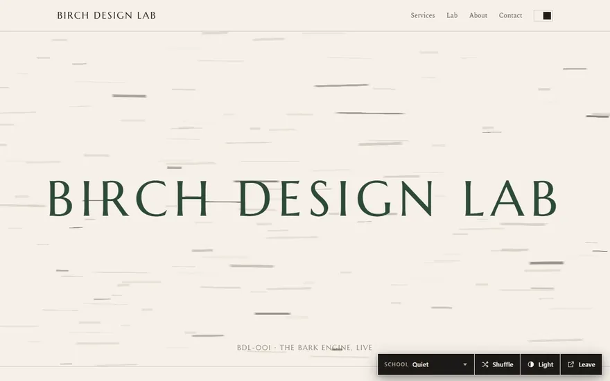
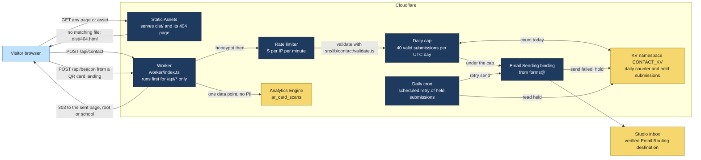
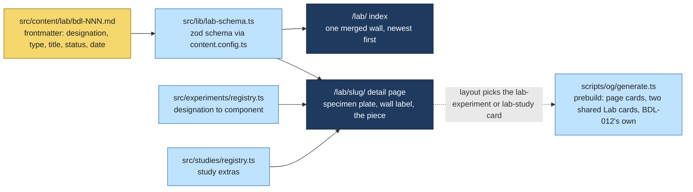
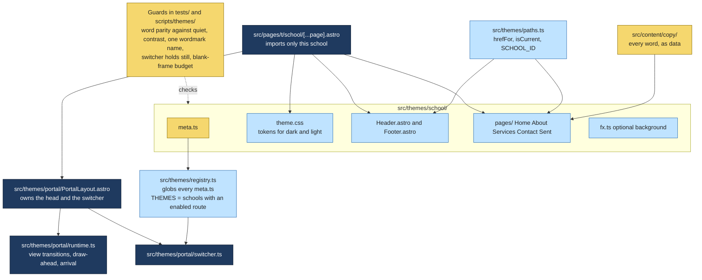
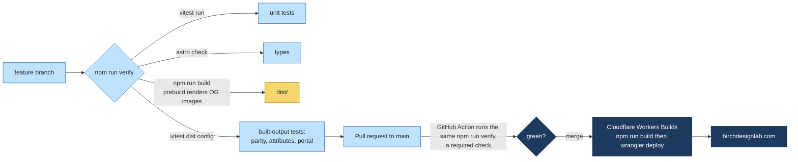
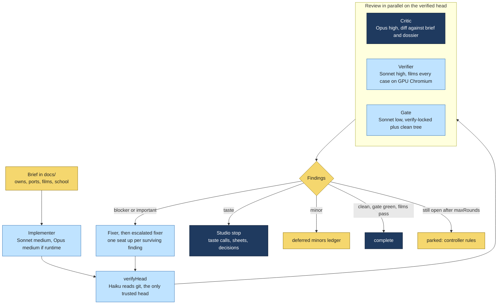
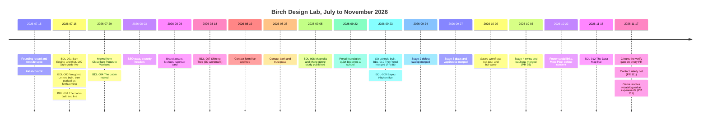

# Birch Design Lab

The source of [birchdesignlab.com](https://birchdesignlab.com/), the business and portfolio site of Birch Design Lab. We are a solo custom software and web design studio, founded in July 2026 on the Mississippi Gulf Coast. The site is an Astro static build served from Cloudflare Workers, with a small Worker for the contact form. The centre of the site is the **Lab**: a growing set of numbered experiments and studies (BDL-001 through BDL-012) that make up our portfolio. One of them, the "Portal", rebuilds the whole site in seven design schools.



Repository: [github.com/BirchDesignLab/birchdesignlab](https://github.com/BirchDesignLab/birchdesignlab). This README is a map for anyone joining the project.

---

## Contents

1. [What is here at a glance](#what-is-here-at-a-glance)
2. [How the site is served](#how-the-site-is-served)
3. [Repository map](#repository-map)
4. [The Lab: specimens](#the-lab-specimens)
5. [The Portal: design schools](#the-portal-design-schools)
6. [Build, verify and deploy](#build-verify-and-deploy)
7. [The Claude Code harness](#the-claude-code-harness)
8. [Timeline](#timeline)
9. [Where it stands and how to help](#where-it-stands-and-how-to-help)
10. [What a clone does not have](#what-a-clone-does-not-have)
11. [Local setup](#local-setup)
12. [House rules](#house-rules)

---

## What is here at a glance

| Fact | Value |
|---|---|
| Live site | [https://birchdesignlab.com/](https://birchdesignlab.com/) |
| Framework | Astro 7 (static output), Svelte 5 islands, three.js for the 3D pieces |
| Host | Cloudflare Workers (Static Assets plus one Worker), deployed by Workers Builds on merge to main |
| Tests | A Vitest suite under `tests/`, plus a second Vitest config (`tests/built/`) that inspects the built `dist/` |
| CI | A GitHub Action (`.github/workflows/verify.yml`) runs `npm run verify` on every pull request and every push to main. `verify` is a required check in the main ruleset, so a red run blocks the merge |
| History | Built since 2026-07-15; over a hundred pull requests by mid November 2026 |
| Dev tooling | Claude Code with saved multi-agent workflows (`bdl-task`, `bdl-wave`) and a strict model-tiering policy |

Public pages: Home, About, Services, Contact (a real form), Privacy, the Lab index and one page per specimen, the Styleguide, three QR-card landings (`/hello/`, `/showcase/`, `/greetings/`) and the Portal at `/t/<school>/`, with five business pages per school. Routes end in a trailing slash.

---

## How the site is served

The Static Assets layer serves everything static from the edge. Only `/api/*` runs the Worker first (`run_worker_first` in `wrangler.jsonc`). Two POST endpoints live there: the contact form and the QR-card scan beacon. A request that matches no file is answered by the assets layer itself, with Astro's `dist/404.html` (`not_found_handling: "404-page"`). The Worker never sees 404s.

The contact route is more than a form handler. It runs a safety net so a lead is not lost:

1. A honeypot field. Bots that fill it get a cheerful success page and no email.
2. A per-IP rate limit of 5 per minute.
3. Validation (`src/lib/contact/validate.ts`).
4. A global daily cap of 40 valid submissions per UTC day, kept in a KV namespace (`CONTACT_KV`). It stops a bot that rotates IPs. The cap is soft and fails open, because a real lead matters more than an exact count.
5. The email send. If it fails, the submission is held in KV for 30 days, the visitor sees a plain "your message is saved" page, and a daily cron (`17 14 * * *`, handled by `scheduled()`) retries every held submission until it sends or expires.



Before you touch this layer:

- `wrangler.jsonc` sets `run_worker_first` for `/api/*`, so the assets layer cannot swallow a browser form POST with a 405.
- The contact form works with JavaScript off. Errors are plain HTML pages, not JSON.
- The recipient must be a verified Email Routing destination. Sending to a routing address like `hello@` returns 502 on the free plan.
- `public/_headers` sets the security headers on static responses. The Worker adds its own two (Referrer-Policy, X-Frame-Options), because `_headers` does not apply to Worker responses.
- There is no Permissions-Policy header, on purpose: the Lab means to use camera, location and sensors. See [docs/deploy.md](https://github.com/BirchDesignLab/birchdesignlab/blob/main/docs/deploy.md).
- Analytics runs at the edge, not in site code. Cloudflare Zaraz loads Google Analytics 4 (Analytics consent) and the Meta Pixel (Marketing consent), opt-in everywhere, and Cloudflare Web Analytics counts page views without cookies. The config of record is [docs/analytics.md](https://github.com/BirchDesignLab/birchdesignlab/blob/main/docs/analytics.md).
- A second, separate Worker lives in `share/`. It serves share.birchdesignlab.com and is deployed by hand, not by Workers Builds.

The Worker, the contact route, secrets, `_headers`, analytics consent and the verify gate are the repo's declared **sensitive code**. Changes there get an Opus-grade review under the house rules.

---

## Repository map

```mermaid
flowchart TB
    classDef store fill:#f5d76e,stroke:#8a6d00,color:#222
    classDef cloud fill:#1f3a5f,stroke:#0d1b2e,color:#fff
    classDef you fill:#bfe3ff,stroke:#2b6cb0,color:#222

    ROOT["birchdesignlab/"]
    ROOT --> SRC["src/<br/>the Astro site"]:::you
    ROOT --> WORKER["worker/<br/>Cloudflare Worker"]:::cloud
    ROOT --> TESTS["tests/<br/>Vitest unit and dist tests"]:::you
    ROOT --> SCRIPTS["scripts/<br/>every script ever run, kept"]:::store
    ROOT --> DOCS["docs/<br/>backlog, live references, specs, archive"]:::store
    ROOT --> SHARE["share/<br/>share.birchdesignlab.com Worker, deployed by hand"]:::cloud
    ROOT --> ASSETS["assets/<br/>brand marks and this README's media"]:::store
    ROOT --> SOCIAL["social/<br/>video and card render pipeline"]:::you
    ROOT --> ATTIC["attic/<br/>parked work, BDL-004 The Loom (retired)"]:::store
    ROOT --> CLAUDE[".claude/<br/>agents, saved workflows"]:::cloud
    ROOT --> PUBLIC["public/<br/>favicons, robots, _headers, draco decoder"]:::you

    SRC --> PAGES["pages/<br/>routes incl. lab/ and t/"]
    SRC --> CONTENT["content/<br/>copy/ and lab/ collections"]
    SRC --> EXP["experiments/<br/>bdl-001 002 003 006 007 012"]
    SRC --> THEMES["themes/<br/>seven schools plus portal/"]
    SRC --> LIB["lib/<br/>bark engine, color, oklch, contact, seo, og, lab-schema, lab-sets"]
    SRC --> COMP["components/ layouts/ styles/"]

    SCRIPTS --> ST["themes/<br/>capture, film, probes, proofs, harness"]
    SCRIPTS --> SB["brand/ og/ lab/ docs/ ar-card/ workflows/ build/ and more"]

    DOCS --> BACK["lab-backlog.md<br/>the only site backlog"]
    DOCS --> SOCB["socials-backlog.md<br/>the social pipeline backlog"]
    DOCS --> LIVE["deploy.md analytics.md ar-card/<br/>live references"]
    DOCS --> SP["superpowers/specs/<br/>specs for live features"]
    DOCS --> TSR["superpowers/specs/theme-schools-research/<br/>dossiers, briefs, stage reports, handoffs"]
    DOCS --> ARCH["archive/<br/>dated handoffs, finished plans, superseded specs"]
```



| Path | What lives there | Start with |
|---|---|---|
| [src/pages](https://github.com/BirchDesignLab/birchdesignlab/tree/main/src/pages) | Every route. `lab/` renders the content collection, and `t/<school>/[...page].astro` is one Portal school each | [index.astro](https://github.com/BirchDesignLab/birchdesignlab/blob/main/src/pages/index.astro) |
| [src/content](https://github.com/BirchDesignLab/birchdesignlab/tree/main/src/content) | `copy/` holds every visitor-facing word as data; `lab/` holds one Markdown entry per specimen | [content.config.ts](https://github.com/BirchDesignLab/birchdesignlab/blob/main/src/content.config.ts) |
| [src/experiments](https://github.com/BirchDesignLab/birchdesignlab/tree/main/src/experiments) | The interactive specimen components, keyed by designation | [registry.ts](https://github.com/BirchDesignLab/birchdesignlab/blob/main/src/experiments/registry.ts) |
| [src/themes](https://github.com/BirchDesignLab/birchdesignlab/tree/main/src/themes) | The seven design schools and the Portal runtime | [README.md](https://github.com/BirchDesignLab/birchdesignlab/blob/main/src/themes/README.md) |
| [src/lib/bark](https://github.com/BirchDesignLab/birchdesignlab/tree/main/src/lib/bark) | The generative birch-bark engine that paints the site's background (BDL-001) | |
| [worker/index.ts](https://github.com/BirchDesignLab/birchdesignlab/blob/main/worker/index.ts) | Contact and beacon endpoints | [docs/deploy.md](https://github.com/BirchDesignLab/birchdesignlab/blob/main/docs/deploy.md) |
| [scripts/themes](https://github.com/BirchDesignLab/birchdesignlab/tree/main/scripts/themes) | Playwright capture, film, strip and proof tooling for the Portal. Hundreds of probe scripts are kept on purpose (see House rules) | [snap.mjs](https://github.com/BirchDesignLab/birchdesignlab/blob/main/scripts/themes/snap.mjs), [stage-gates.mjs](https://github.com/BirchDesignLab/birchdesignlab/blob/main/scripts/themes/harness/stage-gates.mjs) |
| [docs/lab-backlog.md](https://github.com/BirchDesignLab/birchdesignlab/blob/main/docs/lab-backlog.md) | The site backlog: open gates, parked items, future experiments, dependency queue | |
| [docs/socials-backlog.md](https://github.com/BirchDesignLab/birchdesignlab/blob/main/docs/socials-backlog.md) | The social asset pipeline and its work items | [social/README.md](https://github.com/BirchDesignLab/birchdesignlab/blob/main/social/README.md) |
| [docs/birch-design-lab-founding-record.md](https://github.com/BirchDesignLab/birchdesignlab/blob/main/docs/birch-design-lab-founding-record.md) | Why the name, the brand foundation, the naming graveyard | |
| [docs/brand-brief.md](https://github.com/BirchDesignLab/birchdesignlab/blob/main/docs/brand-brief.md) | Visual identity brief | [assets/brand/README.md](https://github.com/BirchDesignLab/birchdesignlab/blob/main/assets/brand/README.md) |
| [docs/ar-card/HANDOFF.md](https://github.com/BirchDesignLab/birchdesignlab/blob/main/docs/ar-card/HANDOFF.md) | The WebAR business card project | |
| [CLAUDE.md](https://github.com/BirchDesignLab/birchdesignlab/blob/main/CLAUDE.md) | Working rules for Claude Code sessions: model tiering, git flow, scripts policy, dependency policy | |
| [.claude/workflows/README.md](https://github.com/BirchDesignLab/birchdesignlab/blob/main/.claude/workflows/README.md) | The saved multi-agent workflows | |
| [share/](https://github.com/BirchDesignLab/birchdesignlab/tree/main/share) | A separate static Worker for sharing pieces at share.birchdesignlab.com. Deployed by hand, never by Workers Builds; the pages it serves are not in git | [README.md](https://github.com/BirchDesignLab/birchdesignlab/blob/main/share/README.md) |

### Docs map: what is current

`docs/` holds live references and history. Read the sources below as current. Treat everything under `docs/archive/` as a dated record of how the project got here, not of how it works now.

| Question | Current source |
|---|---|
| What is planned, parked or owed on the site | [docs/lab-backlog.md](https://github.com/BirchDesignLab/birchdesignlab/blob/main/docs/lab-backlog.md) |
| What is planned for the social asset pipeline | [docs/socials-backlog.md](https://github.com/BirchDesignLab/birchdesignlab/blob/main/docs/socials-backlog.md) |
| Hosting, DNS, email, headers, dashboard steps | [docs/deploy.md](https://github.com/BirchDesignLab/birchdesignlab/blob/main/docs/deploy.md) |
| Analytics, consent, what the privacy page must say | [docs/analytics.md](https://github.com/BirchDesignLab/birchdesignlab/blob/main/docs/analytics.md) |
| Brand marks and how to use them | [assets/brand/README.md](https://github.com/BirchDesignLab/birchdesignlab/blob/main/assets/brand/README.md), [docs/brand-brief.md](https://github.com/BirchDesignLab/birchdesignlab/blob/main/docs/brand-brief.md) |
| The AR business card | [docs/ar-card/HANDOFF.md](https://github.com/BirchDesignLab/birchdesignlab/blob/main/docs/ar-card/HANDOFF.md) |
| How a live feature was designed | [docs/superpowers/specs/](https://github.com/BirchDesignLab/birchdesignlab/tree/main/docs/superpowers/specs) (finished and superseded ones are in `docs/archive/superpowers/`) |
| Where the Portal stands | the newest stage report and handoff under [theme-schools-research/](https://github.com/BirchDesignLab/birchdesignlab/tree/main/docs/superpowers/specs/theme-schools-research) |
| Why the name | [docs/birch-design-lab-founding-record.md](https://github.com/BirchDesignLab/birchdesignlab/blob/main/docs/birch-design-lab-founding-record.md), read with its banner, which marks what is retired |
| How to work in the repo | [CLAUDE.md](https://github.com/BirchDesignLab/birchdesignlab/blob/main/CLAUDE.md) |

---

## The Lab: specimens

The Lab is one Astro content collection with a `type` discriminator. Experiments are self-initiated pieces. Studies are real client work. The two genre studies (sites for fictional businesses) are stored as `type: study` with `genreStudy: true`. That keeps the study page layout and catalogues them with the experiments (`src/lib/lab-schema.ts`, `src/lib/lab-sets.ts`). Accession numbers are permanent and never reused. `/lab/<slug>/` URLs are flat.

| Designation | Title | Type | Status | What it is |
|---|---|---|---|---|
| BDL-001 | The Bark Engine | experiment | live | The generative birch system that paints the site's skin, exposed as a playable instrument |
| BDL-002 | The Styleguide | experiment | live | The tuning room: palettes, typefaces, a colour checker, bark you can grow |
| BDL-003 | Novgorod Letters | experiment | forthcoming (parked) | Medieval birch-bark letters, scratch to read. The engine is built under `src/experiments/bdl-003/`. There is no live page yet; it waits on a visual rework |
| BDL-004 | The Loom | experiment | retired | A weaving-draft instrument in Svelte. Built, shipped, then pulled on purpose. The build sits in `attic/bdl-004/` and the designation is never reused |
| BDL-005 | Cheer and Chatter Social Club | study | live | Ticketing site plus a live event app for game nights. It lives in a sibling repo; this is the write-up |
| BDL-006 | The Regulator | experiment | live | A colour ramp that solves itself against WCAG, and a crown that retunes the bark live |
| BDL-007 | The Shining Tree | experiment | live | The organic wordmark in 3D (three.js, Draco-compressed GLB), birch and moss breathing |
| BDL-008 | Magnolia and Mane | experiment (genre study) | live | Genre study: a Gulf Coast salon site, bilingual, booking on-site |
| BDL-009 | Bayou Kitchen | experiment (genre study) | live | Genre study: a Gulf Coast restaurant site, menu first |
| BDL-010 | The Portal | experiment | live | The whole site rebuilt in seven design schools with a page-morphing switcher |
| BDL-011 | Field Guide to the Schools | study | forthcoming | What each school believes and forbids, and what it took to build it |
| BDL-012 | The Data Map | experiment | live | One picture of everything a small events business runs on, and where its information lives, travels and shows up. Drawn for a client, then hung in the Lab |



Share images are not per entry. The generator renders cards for Home, Services, About, Contact and the Lab index, plus one shared card for experiments and one for studies. Only BDL-012 carries its own committed capture (`src/lib/og/manifest.ts`).

Specimen plates, wall labels and accession numbers borrow from museums, so the Lab reads as a collection and not a list of case studies. The home page's "From the lab" strip shows the three highest-numbered live entries (`featuredSpecimens()` in `src/lib/copy.ts`).

---

## The Portal: design schools

BDL-010 is the biggest piece in the repo. Each **school** is the full business site (Home, About, Services, Contact, Sent) rebuilt in one design language at `/t/<id>/`. Every word, link and form behaviour is shared and fixed. Everything visual belongs to the school. A fixed switcher morphs the page from one school to the next with view transitions, and the wordmark is the one element that pairs across schools.

| School | Route | State at head of main |
|---|---|---|
| quiet | `/t/quiet/` | The root site's own language, used as the parity reference |
| swiss | `/t/swiss/` | Stage 4 revision merged (PR #95) |
| bauhaus | `/t/bauhaus/` | Stage 4 revision merged (PR #95) |
| glassmorphism | `/t/glassmorphism/` | Stage 3 revision merged (PR #93) |
| vaporwave | `/t/vaporwave/` | Stage 3 revision merged (PR #93) |
| grandmillennial | `/t/grandmillennial/` | Tranche 1 build on main; Stage 5 revision on its own branch, not yet merged |
| cottagecore | `/t/cottagecore/` | Tranche 1 build on main; Stage 5 revision on its own branch, not yet merged |



How a school is built and judged:

- Start a draft with `node scripts/themes/new-theme.mjs <id> "<Name>"`. While the route file is named `_[...page].astro`, the switcher and the build ignore the school.
- Decoration is `aria-hidden`. Any visible word that is not in the copy fails **word parity**, which compares every school to quiet word for word.
- Each school has a **dossier** of primary-source research under [docs/superpowers/specs/theme-schools-research/dossiers](https://github.com/BirchDesignLab/birchdesignlab/tree/main/docs/superpowers/specs/theme-schools-research/dossiers). Revisions are judged against it.
- The **stage gates** (`scripts/themes/harness/stage-gates.mjs`) run in steps. They time every school's arrival, film the switcher at desktop, mobile and phone sizes in both schemes and check that it holds still in every strip, run an "unname" control that must fail, and film the wordmark morph. They need a GPU Chromium (`BDL_GPU=1`).
- The research program ran in tiers: Tier 1 fixes, Tier 2 dossiers and a critique panel, then Tier 3 revisions in stages, one pair of schools per stage. Stage 4 (swiss and bauhaus) merged 2026-10-03. Stage 5 (grandmillennial and cottagecore) is built and in review on `feat/theme-schools-tier3-stage5`, not yet merged. Its reports and handoff live on that branch. After it come a Stage 6 re-review of the whole set, the transitions phase, then a second tranche of schools; the big copy pass waits until the schools and transitions ship (see [docs/lab-backlog.md](https://github.com/BirchDesignLab/birchdesignlab/blob/main/docs/lab-backlog.md)).

---

## Build, verify and deploy



- `npm run verify` is the gate and must be clean before any PR. It runs `vitest run`, `astro check`, `npm run build` and then `npm run test:dist` (Vitest over the built `dist/`). It is one command on purpose, because the three-part version was easy to skip. The GitHub Action (`.github/workflows/verify.yml`) runs the same command on every pull request. The check is required, so a red run blocks the merge.
- Workers Builds only builds and deploys. It does not run tests, so CI is where they run before a merge.
- Merging to main **is** the production deploy. There is no staging environment. The safety net is reversibility: revert the commit, redeploy.
- `npm run deploy` is a manual escape hatch for when Workers Builds is down. It builds and deploys with local wrangler auth, bypasses Workers Builds, and ships the working tree, not the committed tree. See [docs/deploy.md](https://github.com/BirchDesignLab/birchdesignlab/blob/main/docs/deploy.md).
- `astro.config.mjs` carries two deliberate build patches. One drops three.js's unused Draco decoder copies from the bundle. The other restores CSS that Astro 7 on Rolldown deletes. Both are documented inline with the symptom that found them.
- Dependencies policy: newest stable, no sitting on reachable advisories, and each major upgrade gets its own PR with a browser pass. `npm audit` findings are triaged, not obeyed.

---

## The Claude Code harness

The repo is built with Claude Code, and we treat its agent fleet as engineering infrastructure. Three things to know.

**Model tiering is mandatory.** Every subagent dispatch sets a model and an effort. The table in CLAUDE.md maps work to seats: Haiku for enumeration, Sonnet for implementation and verification, Opus for critique, design and sensitive code. The rule exists because a fleet of unset, untiered agents burned a month of usage in minutes.

**Saved workflows run the visual work.** `bdl-task` takes one brief-sized task on a feature branch and runs it through implement, verify-head, parallel review and up to two fix rounds. `bdl-wave` chains tasks and carries taste calls forward. Their args, roles and stop points are in [.claude/workflows/README.md](https://github.com/BirchDesignLab/birchdesignlab/blob/main/.claude/workflows/README.md). A mock harness and a mutant suite under `scripts/workflows/` test the workflows themselves, and `verify-locked.mjs` there runs the gate while holding the render lock.



**Everything is recorded.** Each stage ends with a report (for example [stage4-report.md](https://github.com/BirchDesignLab/birchdesignlab/blob/main/docs/superpowers/specs/theme-schools-research/tier3-stage4/stage4-report.md)). It lists what changed, the calls the studio owes, and what still needs checking on a real iOS device after deploy.

---

## Timeline

Dates are local (US Central).



---

## Where it stands and how to help

As of mid November 2026, the last Portal merge is Stage 4 (PR #95, 2026-10-03). Stage 5 is built on `feat/theme-schools-tier3-stage5` and has not merged. [docs/lab-backlog.md](https://github.com/BirchDesignLab/birchdesignlab/blob/main/docs/lab-backlog.md) and the stage reports are the queue, and the studio sets priorities. The Stage 4 taste calls were answered 2026-10-03 and 10-04. What is left from that stage is tracked in the backlog: two end-of-run layout nitpicks, the stretch interactables that were not built, and the temporary `?bh-assembly=` switch on bauhaus pages.

**Next planned work**

- Stage 5: pair C, grandmillennial and cottagecore, through the same dossier-driven revision. It is built and in review.
- Stage 6: a re-review of all seven schools as a set, plus two interactables Stage 4 left unbuilt.
- The transitions phase: give every school its own arrival gesture, draw ahead on in-school links and on phones, fix the Back-to-a-scrolled-page wordmark morph, and film in WebKit as well as Chromium.
- BDL-011 Field Guide to the Schools is `forthcoming`, with a spec written. BDL-003 Novgorod Letters is parked behind a visual rework.

**Standing gaps a second person could own**

- **Safari and iOS.** Every film so far is Chromium, and Playwright WebKit on Windows is not iOS Safari. A tester with a real iOS device and some time would help a lot: touch dragging, `:active` press states, and the checks still owed from earlier stages.
- **Accessibility audit** across the seven schools. The word-parity and `aria-hidden` rules are strict, but nobody has done a screen-reader pass.
- **A Mermaid check in the verify gate**, so the charts in this README stay valid as they change.
- **The AR card** ([docs/ar-card/HANDOFF.md](https://github.com/BirchDesignLab/birchdesignlab/blob/main/docs/ar-card/HANDOFF.md)): the one remaining one-way door is ordering the etched wood card run.
- **Dependency upgrades** per the policy in CLAUDE.md. The queue is in the backlog.
- **Studies.** Real client work, written up as a study, is what the Lab is built to hold.

**How contributions flow**

1. Work on a fork or a branch, run `npm run verify`, and open a pull request against `main`. CI runs the same command and must pass.
2. Keep sensitive code (Worker, contact route, `_headers`, analytics, the verify gate) out of a first PR unless invited.
3. For Portal work, read the school's dossier and the brief format in the stage directories before changing a school. The studio judges Portal work on film sheets, not on code.
4. Follow CLAUDE.md on scripts (commit them, no temp directories). Write no em dashes in anything a visitor can read.

---

## What a clone does not have

A clone or fork holds only the tracked files. The items below live only on the studio's machines or in its Cloudflare account, and are gitignored or external:

| Missing from a clone | Why | Effect |
|---|---|---|
| Cloudflare account, domain, Email Routing, rate limiter, KV namespace, Analytics Engine, Zaraz config | Bindings in `wrangler.jsonc` resolve only in the studio's account, and analytics are configured in the dashboard | `npm run deploy` and `wrangler dev` will not work from a fork. Merging to a fork's main deploys nothing |
| `docs/briefs/`, `docs/pricing/` | Private business documents, kept out of this public repo on purpose | Nothing in the build reads them |
| The pages under `share/public/` (except `_headers`, `robots.txt`, `404.html`) | Pieces served at share.birchdesignlab.com, kept out of git on purpose | Never deploy `share/` from a clone: it would publish an empty site. See [share/README.md](https://github.com/BirchDesignLab/birchdesignlab/blob/main/share/README.md) |
| `public/og/` | Generated by `npm run og` during prebuild | Regenerates locally |
| `scripts/themes/.out/`, `social/out/`, `docs/**/generated/`, `docs/**/*.pdf` | Capture, film, sheet and PDF outputs | The stage reports point at sheets you cannot see without re-running the harness on a GPU machine |
| `docs/refs/`, `docs/private/`, a few working docs, `.superpowers/` | Drafting material and the superpowers plugin state | Some handoffs reference them. The tracked specs are the record |
| `graphify-out/` | Output of a retired local tool, gitignored | Not needed to build |
| `assets/brand/logos/3d/*.obj` and `.mtl` | 60 MB or more per asset | The `.glb` exports are tracked and are what the site uses |
| `.dev.vars` or any secret | Gitignored. None are needed, because the Worker has no API keys | Nothing to configure |
| The specimen sibling repos | Separate private repos, deliberately unnamed here | BDL-005, 008 and 009 are write-ups of work held elsewhere |

Builds, tests and the dev server all work without any of these.

---

## Local setup

```bash
git clone https://github.com/BirchDesignLab/birchdesignlab.git
cd birchdesignlab
nvm use            # .nvmrc pins Node 24.22.1; package.json requires >=24.22.1
npm install
npm run dev        # http://localhost:4321
npm run verify     # tests, astro check, build, dist tests
```

Optional: `npx playwright install chromium` for the capture and film scripts under `scripts/themes/`. They expect a GPU renderer, and a software renderer fails the film gate by design.

`scripts/readme/portal-loop.mjs` regenerates the hero loop at the top of this README against a local preview build. Usage is in that file's header comment.

---

## House rules

Pulled from [CLAUDE.md](https://github.com/BirchDesignLab/birchdesignlab/blob/main/CLAUDE.md) and [docs/lab-backlog.md](https://github.com/BirchDesignLab/birchdesignlab/blob/main/docs/lab-backlog.md), plus the studio's writing rules, in the order you are likely to hit them.

- Branch and open a PR. Never commit to main. Merging deploys.
- Run `npm run verify` as one command before every PR. CI enforces the same.
- Scripts stay in the repo under `scripts/`, never in a temp directory. One-off probes included.
- Every subagent sets model and effort.
- Newest stable dependencies; majors get their own PR and a browser pass.
- No em dashes in anything a visitor can read. We write as the studio, "we".
- A fictional specimen's hero is a screenshot. No study names the framework behind the specimens.
- Accession numbers are immutable.
