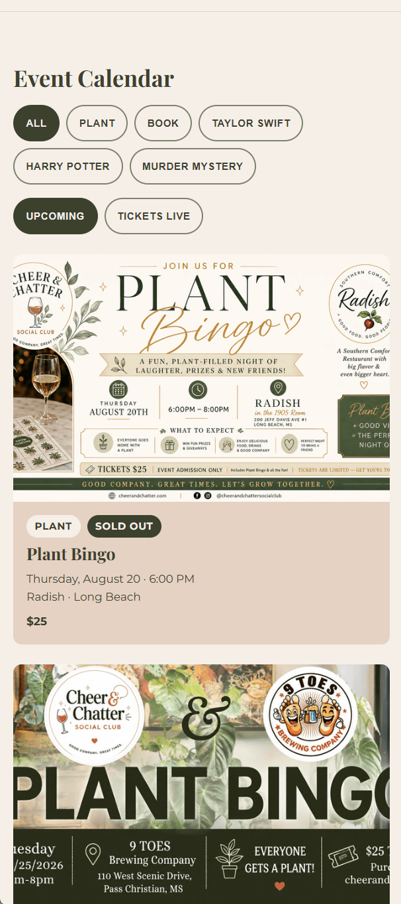
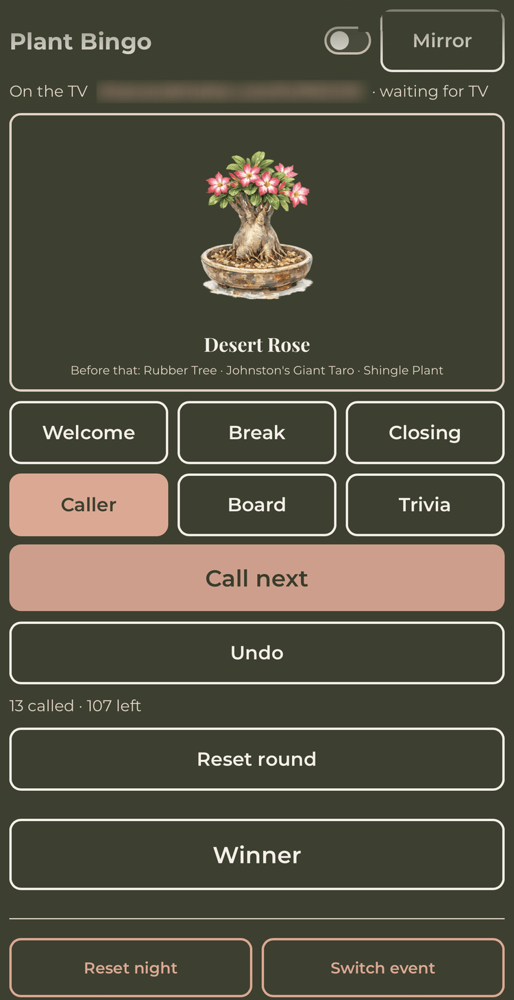
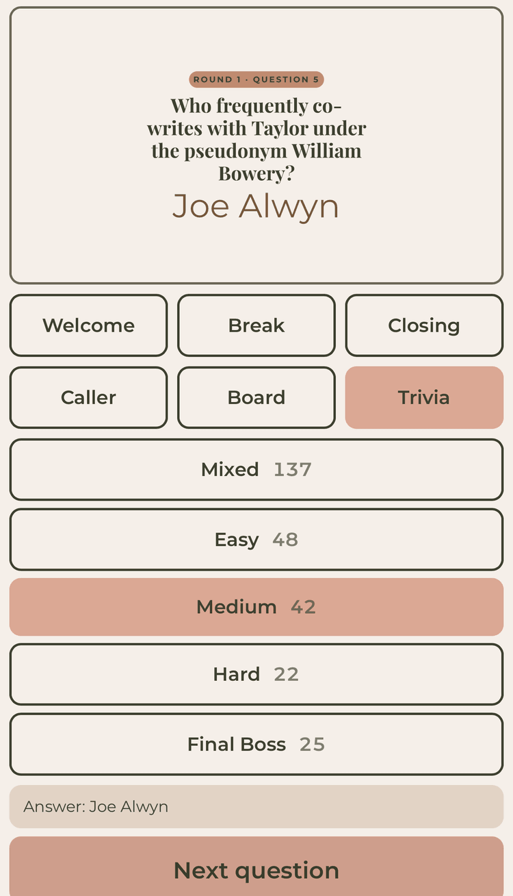
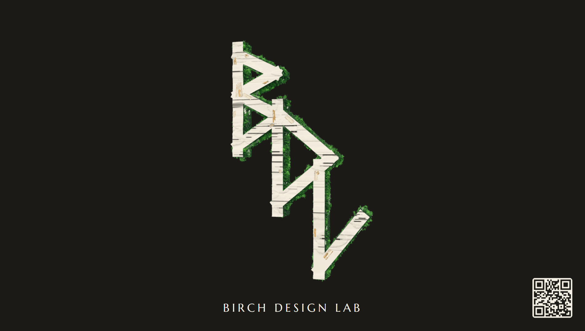
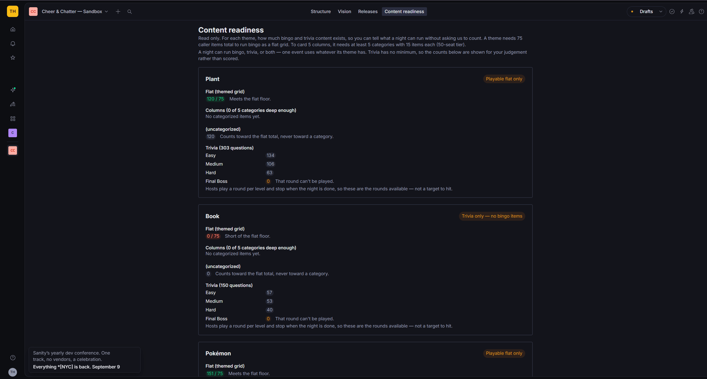
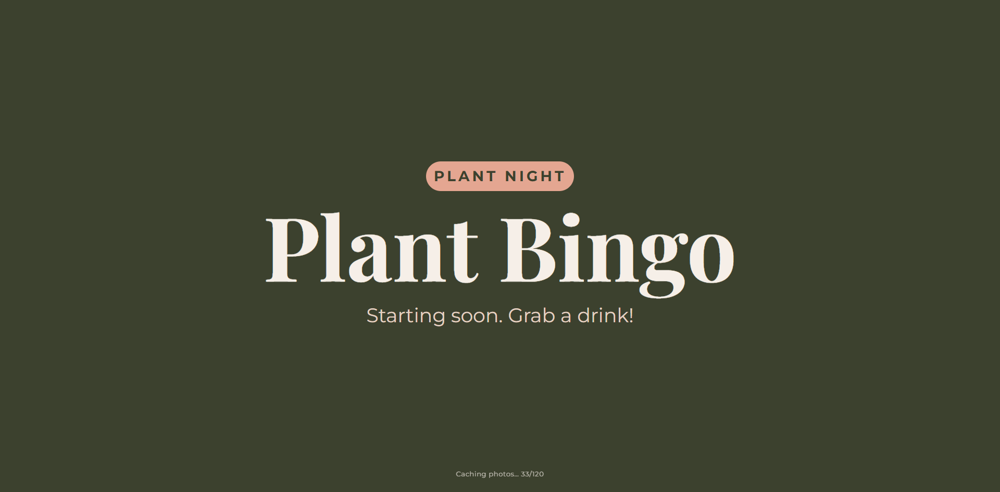
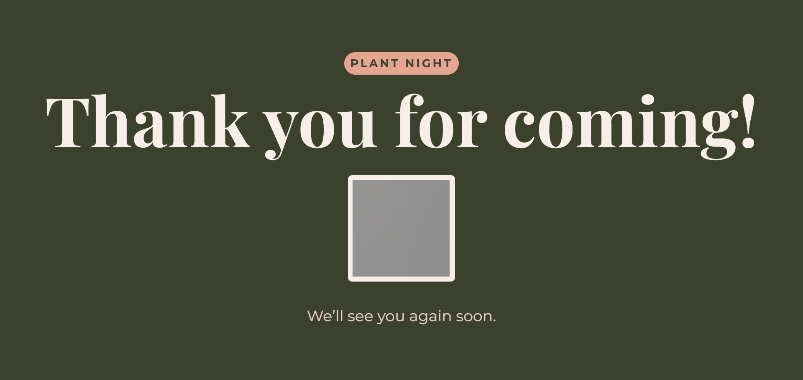
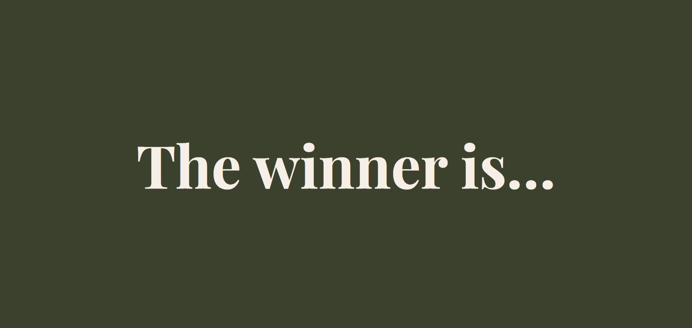
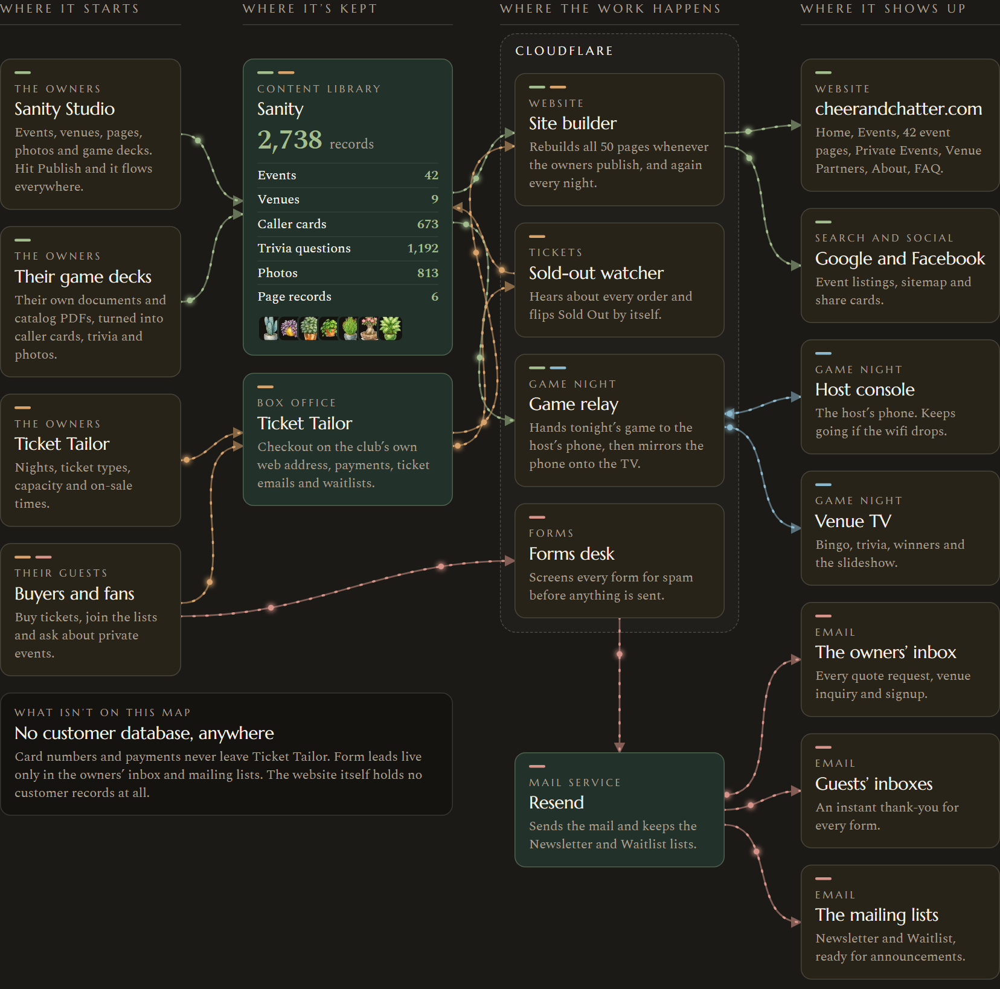

Cheer and Chatter Social Club runs themed game nights across the
Mississippi Gulf Coast. Plant Bingo, Blind Date with a Book, Harry Potter
Bingo, murder mysteries, private bookings. A couple with three young kids
building the kind of gathering place they wished existed, where people put
their phones down and meet each other.

They came to us as the business was being stood up, needing two things: a
site that sells tickets, and a way to actually run game night. Six weeks
later both were real, and had been proven in front of paying rooms: the
site went live on day thirteen and the first two ticketed nights sold out.

That was August. The system has kept working and kept growing since, and the
whole of it is now drawn as a map you can operate:
[BDL-012, The Data Map](/lab/bdl-012/).

## The site

A marketing and ticketing site where the owners control every word without
touching code. Events, venues, page copy, and game content all live in
Sanity; the site rebuilds itself on every publish and again each morning,
so yesterday's event retires itself without anyone remembering to do it.

Ticketing is content too. Each night carries one number, its series ID at
the box office, and the site does the rest: every build asks Ticket Tailor
for that night's checkout and sets it into the event page, on the club's own
domain. When the last ticket sells, the box office tells the site directly.
The site checks that the message is genuine, asks for the real count rather
than trusting it, and only then flips the page to sold out. It flips back if
a ticket is refunded. On event day, nobody touches anything.

The same discipline runs through the whole model: there is a field for
everything and everything lives in its field. The event page, the calendar
cards, the search listing Google assembles, and the waitlist email that
names the right night are all composed from the same structured facts,
entered once.

Every vendor account belongs to the owners. Domain, hosting, content
studio, email, ticketing. If we vanished tomorrow, they lose nothing.

> House rule: the client owns their own shop. We hold keys, not deeds.

## The live event application

The interesting half. Game night needs a caller, a board, and a room that
can see both. So the site grew an auth-gated live area: the host runs the
night from a phone, and the venue TV shows the crowd screen. The two pair
by a five-character code, connect from any network, and stay in sync
through a small realtime worker that costs nothing while idle.

Pairing by typed code rather than a cast button is not a shortcut, it is the
only door iOS leaves open. An iPhone can mirror itself to a television, but
mirroring throws the *whole device* at the room, host console and all, which
is precisely the setup the two-device design exists to replace. Handing a
page to the TV's own browser is not something iOS will do, and every
alternative costs the client hardware. So the code got designed properly
rather than apologized for: five characters from an alphabet with no
lookalikes in it, remembered by both devices, typed once at the first venue.

Bingo came first and ran a real room on August 8. Then trivia grew from a
footnote into a round system: a tap starts the next round at a chosen
difficulty, from a gentle opener up to a Final Boss round, no question ever
repeats across a night, the TV holds a round splash while the host works the
room, and every tier button carries a live count of what's left. The best
code is the code a sharp data model makes unnecessary.

The content pipeline behind it: by October, eleven hundred ninety-two trivia
questions and six hundred seventy-three caller cards across six photo decks,
parsed out of the owners' own documents and catalog PDFs by import scripts
that write to the practice dataset unless told otherwise in as many words.
Before an event, the night's art caches onto the device, so a venue with
bad wifi cannot take the show down. If the phone dies mid-round, the whole
night resumes where it stood: board, winners, round, and which questions
have been asked.

> We rehearsed the whole thing in a living room with a phone and a smart TV
> before the first real night. Rehearsal catches what tests cannot, including
> a TV keyboard that capitalizes room codes. The round system got the same
> treatment: run exhaustively in development, then rehearsed by the owners at
> their own house before it took a paying room.

## The break screen

Everything in the app holds still on purpose; the content is the show. The
one exception is the break screen: an auto-advancing loop that thanks
tonight's venue, shows the club, and gives sponsors a card. Its centerpiece
is ours: a continuously rotating 3D model on the Birch Design Lab card,
compressed from a 12MB export to 3MB, judged by eye against the original
before it shipped, with a committed still of the model standing behind it
as the no-JavaScript insurance. The rule that the whole screen obeys was
written down before the first frame moved: nothing the room sees may depend
on code that might not arrive.

## The controls they keep

The owners run everything through Sanity Studio, including a readiness
gauge that counts their content pools per theme, per difficulty, so they
know a night is playable before they announce it. The gauge is honest
enough to say "enough for a smaller card" instead of failing a 60-item
deck that was built for a 3x3 night. The event picker only lists nights
that can actually run.
Validation talks like a person: a duplicated event still carrying its
original's web address gets a sentence telling the owner exactly which
button fixes it, because the failure it prevents is two events sharing one
page and one mailing list.

## In the room

Software for a live event only proves itself in the room, so we kept turning
up to the rooms.

At one August night at the original venue, the television ran behind the
host's phone. The screens are mounted out of reach, with no HDMI a device can
borrow, so the only way onto that TV was an iPad mirroring itself across a
single bar of borrowed wifi, and a continuously rotating 3D frame is the
worst thing you can ask a mirror to compress. The lag looked like the app's
fault. It was the mirroring link, and we could measure the difference. The
response was to make the app stop depending on the part of the chain it does
not control: the night's photos and the 3D decoder now cache onto the device
before doors, the crowd screen installs as a standalone app with no browser
chrome, and a readiness line confirms it all arrived before the room fills.
The screen that lagged was exonerated, and we hardened it anyway.

The night also learned how to end. One host tap sent the TV into a send-off
rotation that thanked the room and the venue and finished on a QR to the next
events. Then the owners told us what the room had told them: the code was
small, and it cycled away before a phone could find it. So the ending got
simpler. Closing is now one still screen, a thank-you, one large QR and one
caption, with nothing moving. The app used to end when someone turned the
television off. Now the room leaves scanning.

Then the two-device model traveled. A second venue, a new network, the same
five-character code, and a room that sold out and then some: sixty tickets
gone before the doors opened, and the extras the owners carried in to sell at
the door gone as well. And when a small friction surfaced in that paying
room, the previous winner lingering on the TV while the host typed the next
name, it was root-caused, fixed, checked against the whole test suite, and
merged before midnight the same night.

> The fixes came the same night as the events that revealed them. Shipped and
> tested is not the same as played, and played is where the last bugs live.

## Since launch

The engagement did not end at v1. Some of what has shipped since:

Private bookings got a real page: corporate, team-building and holiday
packages, built from the owners' own answers about minimums and upgrades.

The forms learned manners. A rejected submission now names the exact field
to fix, in a plain sentence, instead of a red box and a shrug.

The box-office link got stricter. Every order message is checked for a
genuine signature before the site acts on it.

The calendar outgrew its first shape, so the Studio now sorts nights into
Upcoming, Past and All. New themes kept arriving, each with its own deck or
question set, along with four murder mysteries across nine showings.

Both owner manuals were rewritten against the running system, with fresh
screenshots, and anything we could not verify working was cut rather than
described.

And we drew the owners a picture of the whole thing, so they could see how
the pieces they use every week fit together. That drawing is BDL-012, The
Data Map, and it can be operated:

## The shape of the work

Six weeks from first commit to a delivered v1, about two months of heavy
building in all, and steady small refinements ever since. As of November
2026: thirty-three thousand and fifty-six lines of code across the
application and its supporting scripts and tests, in eight hundred fifteen
commits across two hundred forty-five merged pull requests, seven hundred
one automated tests, and two owner manuals written against the finished
system so the site and the live app can be run without calling us. The site launched on day
thirteen and sold out its first two ticketed nights; by October the calendar
held forty-two nights and showings at nine venues in six cities.

> Everything on this page is the same kind of work the Lab practices in
> the open. The experiments are how we sharpen it; this is where it cuts.
