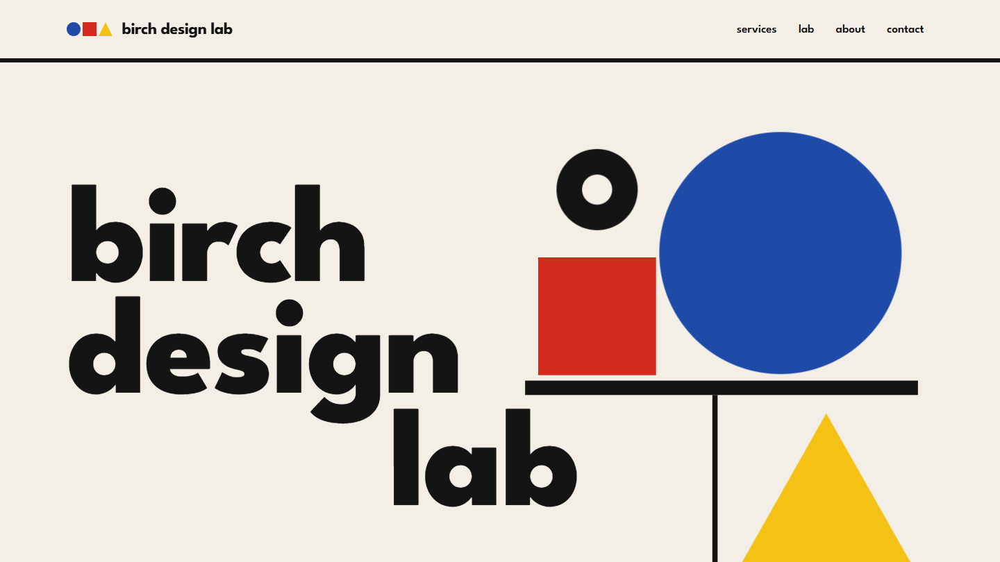
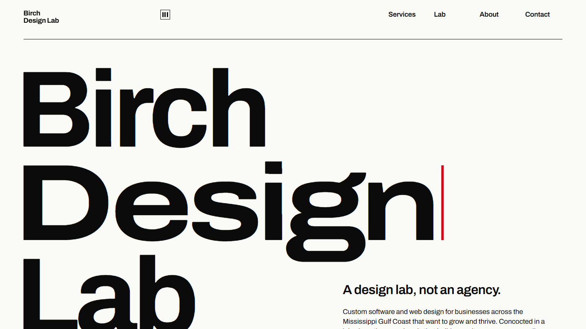
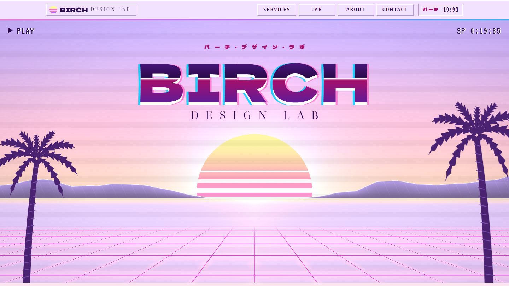
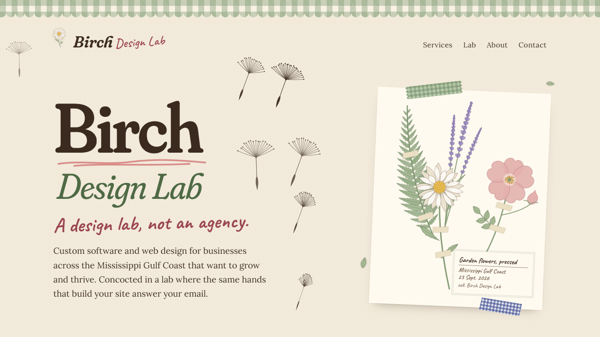
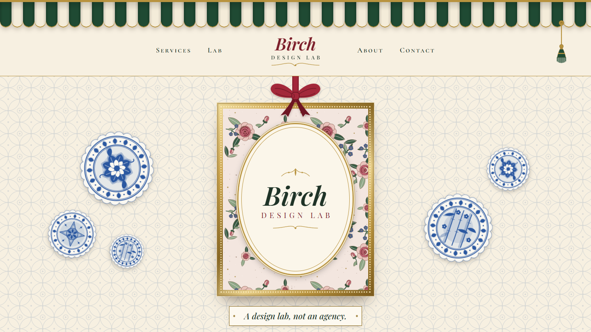
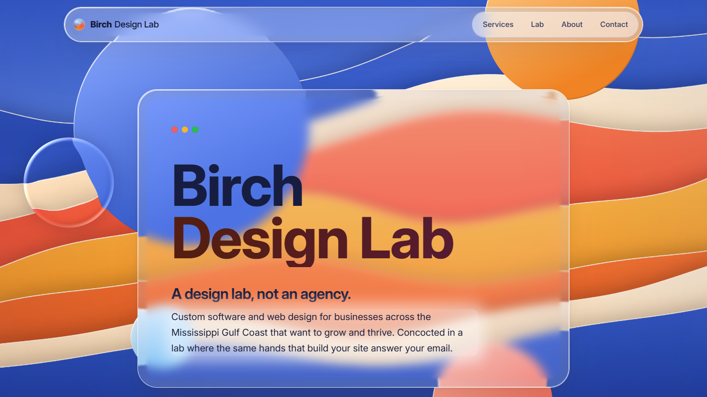

<!--
Live since 11-22-26. Being live also shows the switcher's "how these were
built" link (PortalLayout reads this entry's status).
Rules for edits: no contrast ratios, timings or sizes unless re-measured; the
bauhaus placard's "form follows function" is Sullivan's phrase and is not
repeated here; credit the shape-color pairing to Kandinsky.
-->

The Portal (BDL-010) rebuilds this site's five main pages in one design style after another. This is the guide to the first six: what each one believes, what it refuses, and what went wrong on the way.

## The rules

The words never change. A check reads every visible word on every page of every style against the plain site, and fails if one is missing, added or reworded. The links stay, the contact form works, and every style has its own light and dark.

Everything else belongs to the style: grid, type, color, ornament, motion, even the order of the sections. Each one also hides things to touch. Each name below opens that style.

## [Bauhaus](/t/bauhaus/)

*Weimar and Dessau, 1919 to 1933*

**Believes:** a few plain shapes on a grid, each doing a job.

**Forbids:** pastels, pattern fills, squiggles, brown, texture, serif type, gradients.

The yellow triangle, red square and blue circle are Kandinsky's pairing, and this style keeps it everywhere. Dessau printed in a single case, so every heading is lowercase. The hard part was reading: blue on black and yellow on white are close to unreadable, so the primaries only ever appear as solid blocks, and black ink carries the text.

**Try this.** Drag the shapes off the poster and let go. On About, a card asks which color belongs to which shape, then shows Kandinsky's answer.

## [Swiss](/t/swiss/)

*Zurich and Basel, 1950s to 1960s*

**Believes:** a grid, one type family and one red can organize anything.

**Forbids:** ornament, gradients, rounded corners, more than one accent color, serif type, shadows, icons.

One family, Archivo, and every space measured in lines of body text. The lesson was that flush left is judged by the eye, not the ruler: at poster size each heavy letter sat visibly off the line, so we corrected every giant by hand. The grid itself is never drawn. It is meant to be felt.

**Try this.** Hold G, or the grid key in the header, to see the columns. Drag the word "Design" sideways to widen or condense it.

## [Vaporwave](/t/vaporwave/)

*The internet in the 2010s, dreaming of mid-90s software and shopping malls*

**Believes:** comfort was always for sale, so borrow the mall, the operating system and the museum gift shop.

**Forbids:** gold, script faces, frosted glass, the primary triad, wood grain.

The header is a taskbar with a clock stopped at 19:93, and titles are file names: web_design.htm, setup.exe, mail.txt. Our first grid floor drove endlessly forward, and that is a different scene: the night drive under a neon sunset belongs to outrun. So the floor now loops with a visible seam and a jolt, the way a tape does.

**Try this.** Press PLAY on the tape display to pause it; hold it to fast-forward. After you send a message, open birch.exe on the desktop.

## [Cottagecore](/t/cottagecore/)

*2018 to 2020, after rural crafts and old recipe books*

**Believes:** a page should look made by hand, not manufactured.

**Forbids:** neon, chrome, the primary triad, frosted glass, geometric sans display type.

The handmade here comes from William Morris, who wanted "obvious traces of the hand of man," and from the herbarium: a pressed specimen, flat and still, with a label saying where and when it was gathered. Every card is set down at its own slight tilt. The traps are the twee and the mass-market rustic. At night the same table sits under lamplight, and each firefly keeps its own time.

**Try this.** Tap the dandelion clock at the foot of the home page. On About, drag the needle across the hoop to sew a stitch.

## [Grandmillennial](/t/grandmillennial/)

*Parlour revival, 2019, after 1900s to 1960s interiors*

**Believes:** more is more, when it is edited.

**Forbids:** neon, frosted glass, the primary triad, visible grids, sans-serif display type.

Young people choosing their grandparents' furnishings on purpose: pattern on pattern, held by one strict palette of cream, hunter green, oxblood, porcelain blue and a little gold. Our first toile was scattered sprays of leaves, which is not toile. The one that shipped has six engraved scenes to a tile, a grove of birches and a sundial among them, in a single ink.

**Try this.** Tug the bell-pull tassel on the awning. Brush the plates and they swing. On Contact, press the wax seal.

## [Glassmorphism](/t/glassmorphism/)

*Big Sur and Windows 11, 2020 to 2021*

**Believes:** depth comes from blur and translucency, and legibility is the whole problem.

**Forbids:** serif type, ornament, hard black rules, paper grain, pattern fills.

Text over drifting color has no fixed background, so we checked the text against the deepest color that can drift behind it. Our first glass was milky; we cut the fills back and gave body text its own soft plate. Glass that truly bends what is behind it runs only where the browser can do it, with frosted glass everywhere else.

**Try this.** Use the tiles under the hero to change the frost and the time of day. Throw the lens.

## Six rule books

The same words went through six rule books that disagree on almost everything, down to capital letters. Not one word moved.
